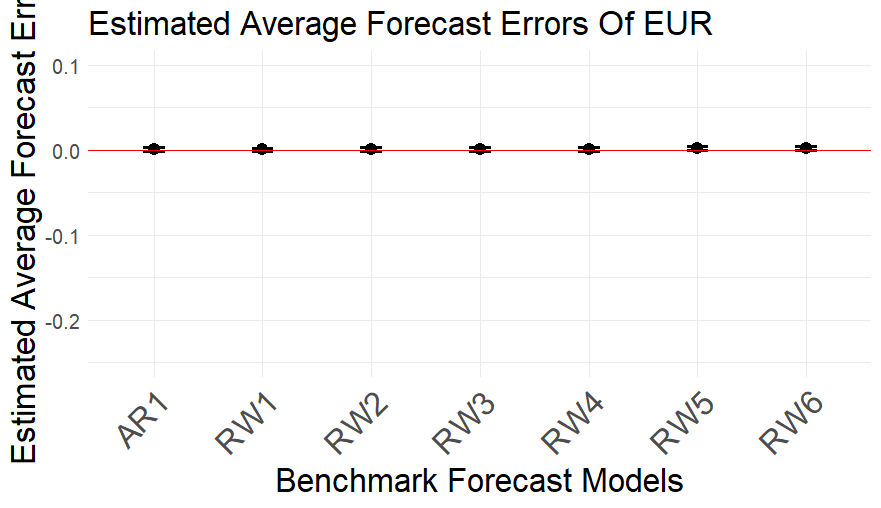
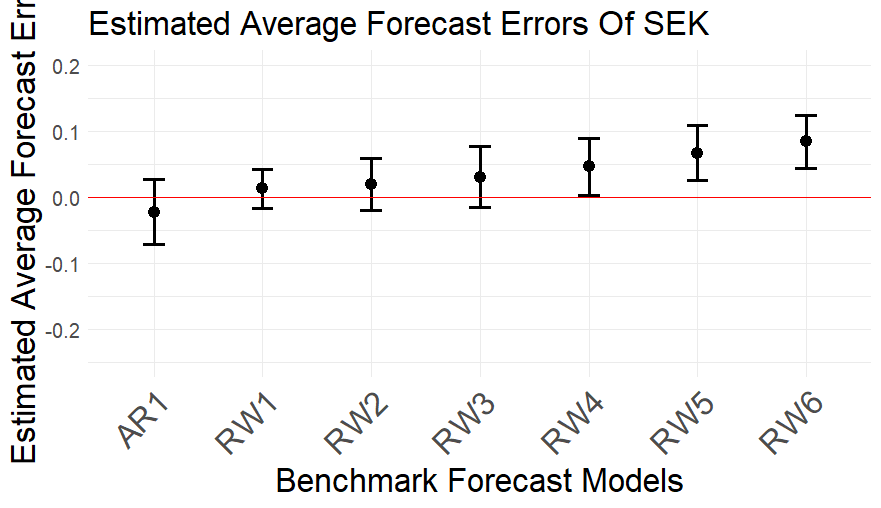

# Forecasting Exchange Rates with AI (Copilot vs. Gemini)

**Can generative AI tools forecast exchange rates better than simple statistical models?**

This project collects real-time, genuinely out-of-sample exchange-rate forecasts from **Microsoft Copilot** and **Google Gemini** and evaluates them against classic benchmarks (**random walk** and **AR(1)**) using standard forecast-evaluation methods in **R**.

*Hafsah Alhassan · Econ 5041, Ohio University · April 2026*

---

## Key findings
- **Stable currencies (EUR, GBP, CHF):** both AI tools produce small, roughly unbiased forecast errors.
- **More volatile currencies (NOK, SEK):** forecasts are much weaker. Under the basic prompt, Copilot consistently under-predicts SEK (average forecast error ≈ −1.3).
- **Prompting matters:** giving the AI the previous day's closing rate (Prompt 2) sharply reduced Copilot's errors.
- **Directional accuracy:** Gemini had the edge under Prompt 1, correctly calling the direction of every move for SEK, NOK and CHF.
- **Benchmarks still win:** Diebold–Mariano–West tests show neither AI tool consistently beats the random walk or AR(1), consistent with Meese & Rogoff (1983).

## Data
| | Details |
|---|---|
| **Currencies** | Euro, British Pound, Norwegian Krone, Swedish Krona, Swiss Franc (units per USD) |
| **Horizons** | 1 to 6 business days ahead |
| **AI tools** | Microsoft Copilot, Google Gemini, each with 2 prompts |
| **Collection window** | 5 consecutive business days starting 9 March 2026, a fresh chat for every prompt |
| **Actual rates** | FRED daily exchange rates (Federal Reserve Bank of St. Louis), April 2021 to April 2026 |

## Methods
1. **Forecast errors**: raw errors `e = actual − forecast` and percent errors.
2. **Accuracy**: Average Forecast Error (AFE) and Root Mean Squared Prediction Error (RMSPE) by tool, prompt, currency and horizon.
3. **Directional accuracy**: Mean Directional Error (MDE).
4. **Benchmarks**: random walk and AR(1) forecasts estimated on five years of FRED data.
5. **Unbiasedness**: regression-based test of H₀: E[e] = 0.
6. **Relative accuracy**: Diebold–Mariano–West test with the Harvey–Leybourne–Newbold small-sample correction.
7. **Copilot vs. Gemini**: panel regression of the difference in squared percent errors on horizon, currency and day effects, with Newey–West standard errors.

## Example output
Estimated average forecast errors of the benchmark models (EUR and SEK):

  
  

## Files
| File | What it is |
|---|---|
| `forecasting_analysis.R` | Full analysis: data cleaning, forecast errors, benchmarks, tests, panel regression |
| `copilot_forecasts.csv` | Copilot forecasts by day, horizon, prompt and currency |
| `gemini_forecasts.csv` | Gemini forecasts, same layout |
| `actual_exchange_rates_fred.csv` | Actual daily exchange rates from FRED |
| `afe_*.png` | Average forecast error plots for each currency |

## Tools
R · tidyverse (dplyr, tidyr, readr, ggplot2) · stargazer · FRED data

## Limitations and next steps
The evaluation window is only five business days, which limits statistical power, and results depend on the exact prompt wording. A natural extension is a longer collection period and more structured prompting.
